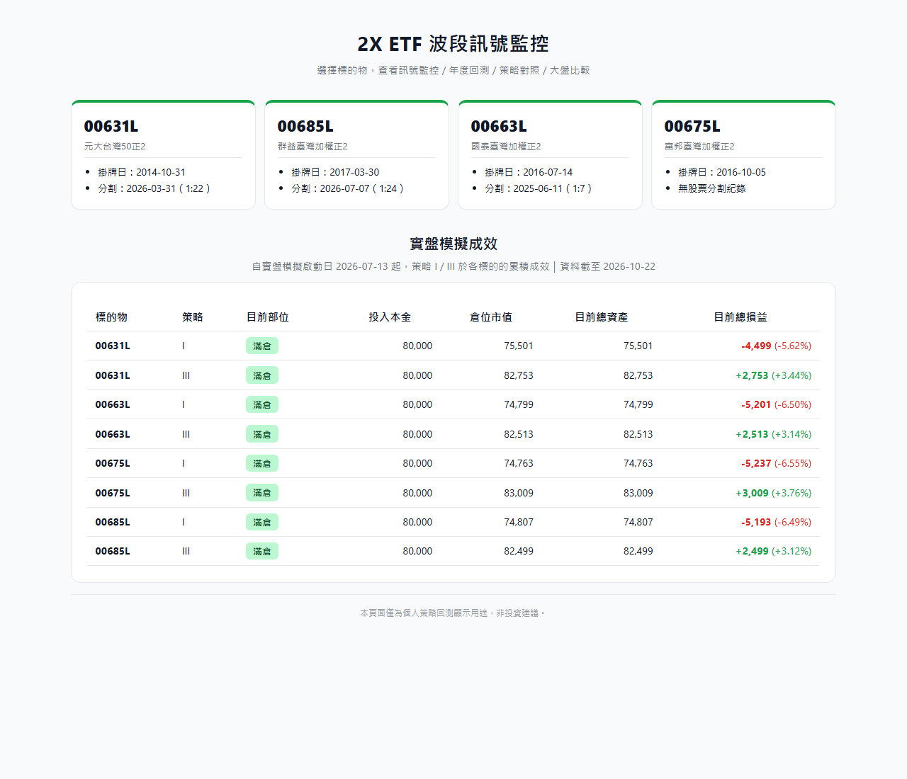
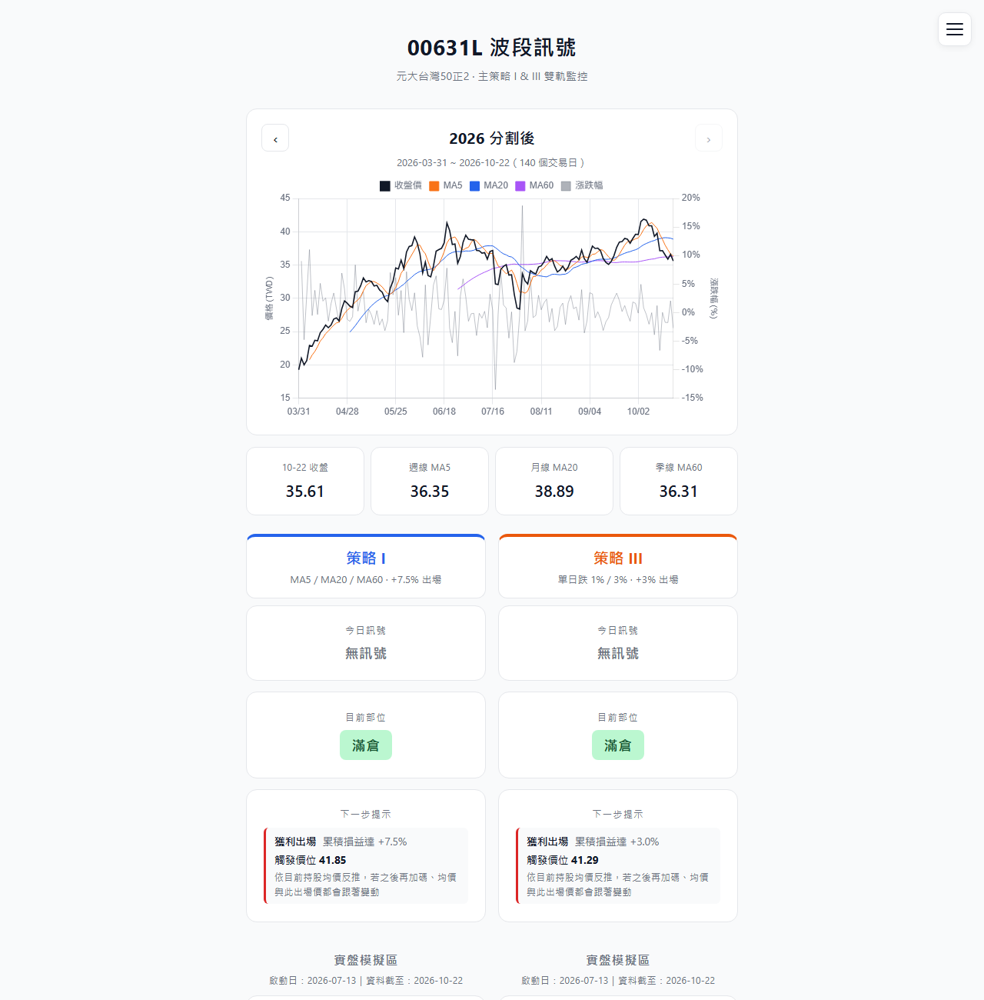
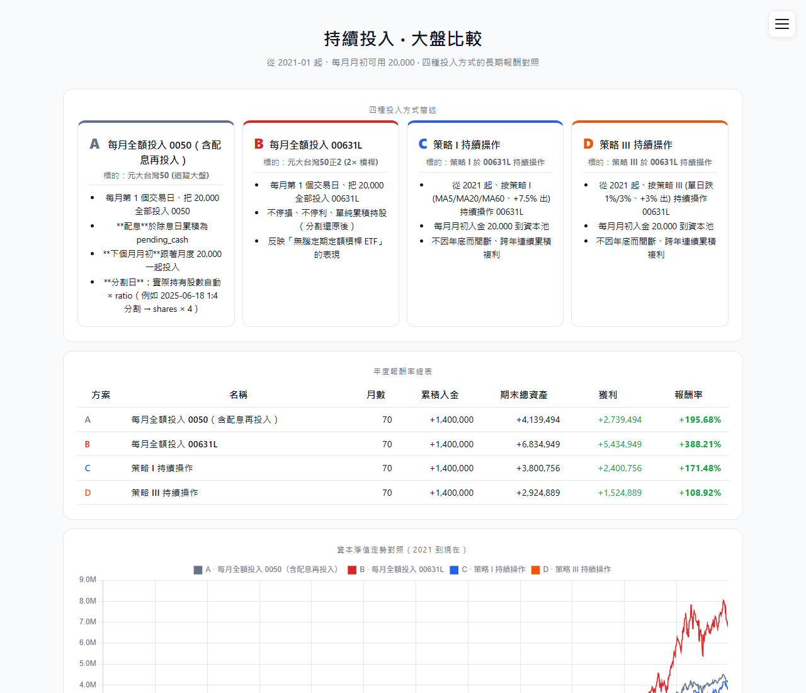
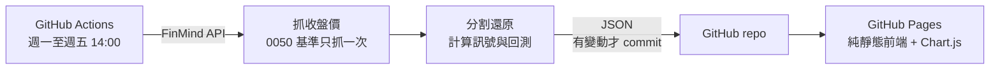

# 2X ETF Monitor — 台股正 2 槓桿 ETF 波段訊號監控

台股 2 倍槓桿 ETF（00631L／00663L／00675L／00685L）的波段進出場訊號監控工具。
以 MA5（週線）／MA20（月線）／MA60（季線）與單日跌幅判斷訊號，搭配「每月固定入金＋資本池分批投入」的資金管理模型，
取代憑感覺進出場。每個交易日收盤後由 GitHub Actions 自動抓資料、算訊號、更新網頁，**全程零人工介入**。

> 純顯示用途，**非投資建議、不自動下單**。

**線上版：** [ping-hsun-chiang.github.io/2X-ETF-monitor](https://ping-hsun-chiang.github.io/2X-ETF-monitor/)




---

## 要解決的問題

正 2 槓桿 ETF 漲跌幅是大盤的兩倍，適合分批逢低布局，但實際操作時很容易：

- **憑感覺進出場：** 跌的時候不敢買、漲的時候追高，沒有一致的規則。
- **每天盯盤：** 要自己算均線、看跌幅，才知道今天該不該動作。
- **不知道策略到底有沒有用：** 沒有回測，也沒有和「直接買大盤」比較過。

這個工具把規則寫成程式，每天自動算好「今天的訊號是什麼、下一步在什麼價位觸發」，打開網頁就能看到；
同時用歷史資料回測，**誠實比較策略和單純定期定額的差別**。

## 功能

- **標的選擇頁：** 列出所有監控中的 ETF（掛牌日、分割紀錄），以及每個標的、每個策略的實盤模擬損益總覽。
- **每日訊號（雙軌）：** 同時顯示策略 I（均線）與策略 III（單日跌幅）的今日訊號、目前部位，
  以及**下一步提示**：依目前持股均價反推觸發出場的價位，並標示是否超出單日 ±20% 漲跌幅限制。
- **價格圖表：** 收盤價、MA5／MA20／MA60 與單日漲跌幅，可依分割前後切換區段。
- **年度回測：** 主策略每年的進出場紀錄與報酬率。
- **五策略對照：** 策略 I～V 在 2021～2026 每年的報酬率比較。
- **持續投入・大盤比較：** 同樣每月 20,000，比較 0050 定期定額、標的物定期定額、策略 I、策略 III 四種做法的長期結果。

| 每日訊號（00631L） | 持續投入・大盤比較 |
| --- | --- |
|  |  |

## 策略與資金模型

### 資金模型

- **月度入金：** 每月第一個交易日，資本池 +20,000。
- **資本池可累積：** 沒觸發訊號的月份，錢會留在池裡；觸發時一次投出。
  例：3 個月沒訊號後池子有 60,000，第一批投 30,000，第二批投入剩下的 30,000。
- **獲利複利：** 出場後全部持股 × 出場價回到資本池，下一輪進場的基數變大。

### 策略 I（均線，主策略）

| 目前部位 | 觸發條件 | 動作 |
| --- | --- | --- |
| 空手 | 收盤 < MA5 且資本池 > 0 | 第一批：投入**資本池 × 0.5** → 半倉 |
| 半倉 | 收盤 < MA20 且資本池 > 0 | 第二批：投入**剩餘資本池** → 滿倉 |
| 半倉／滿倉 | 收盤 < MA60（本輪首次） | MA60 警戒（純提示，不自動加碼） |
| 半倉／滿倉 | 累積損益 ≥ +7.5% | 全數出場 → 空手 |

### 策略 II～V（單日跌幅）

| 策略 | 第一批 | 第二批 | 出場 |
| --- | --- | --- | --- |
| II | 單日跌幅 > 1% | 單日跌幅 > 3% | 損益 ≥ +2% |
| **III**（實盤第二軌） | 單日跌幅 > 1% | 單日跌幅 > 3% | 損益 ≥ +3% |
| IV | 單日跌幅 > 1.5% | 單日跌幅 > 3.5% | 損益 ≥ +2% |
| V | 單日跌幅 > 1.5% | 單日跌幅 > 3.5% | 損益 ≥ +3% |

### 行為細節

- **同日連鎖觸發：** 當天同時跌破 MA5 與 MA20 時，同一天先投第一批、再投第二批。
- **不允許當日進出：** 進場當天不會出場，至少隔一個交易日。
- **MA60 警戒只報一次：** 只在有部位且本輪首次跌破時提示，同一輪不重複；是否手動加碼由使用者判斷。
- **損益率** = 當前收盤 ÷ 持股均價 − 1。

## 回測結果

### 持續投入・大盤比較（2021-01 起，每月 20,000，共 70 個月、累積投入 1,400,000）

| 方案 | 00631L | 00663L | 00675L | 00685L |
| --- | ---: | ---: | ---: | ---: |
| A. 每月全額投入 0050（含配息再投入） | +195.7% | +195.7% | +195.7% | +195.7% |
| B. 每月全額投入該標的（買進持有） | **+388.2%** | **+391.4%** | **+389.2%** | **+402.1%** |
| C. 策略 I 持續操作 | +171.5% | +178.6% | +179.3% | +171.6% |
| D. 策略 III 持續操作 | +108.9% | +96.7% | +106.0% | +114.9% |

**誠實的結論：** 在 2021～2026 這段整體向上的行情中，**兩種波段策略的長期報酬都輸給單純定期定額買進持有**，
甚至不如定期定額 0050。原因是波段策略達到獲利門檻就全數出場，資金常常留在資本池裡等下一次訊號，錯過了後續的主升段。

這個比較正是做這個頁面的目的：讓策略和最簡單的基準並排，而不是只看策略自己賺了多少。

### 五策略年度報酬率（00631L，各年度獨立計算）

| 年度 | I | II | III | IV | V |
| --- | ---: | ---: | ---: | ---: | ---: |
| 2021 | 13.33% | **20.83%** | 18.63% | 19.28% | 15.75% |
| 2022 | −3.08% | −2.95% | −2.99% | −2.95% | **−2.93%** |
| 2023 | 11.71% | 13.29% | 14.34% | 11.32% | **15.11%** |
| 2024 | **8.16%** | 0.39% | 1.24% | −2.68% | −1.39% |
| 2025 | 22.74% | 24.67% | **30.68%** | 20.48% | 26.70% |
| 2026 | **25.21%** | 6.18% | 11.81% | 6.67% | 12.63% |

- 沒有任何一個策略每年都最好；跌幅型策略在波動大的年份（2021、2025）表現較好，均線型策略在緩漲的年份（2024、2026）較穩定。
- 這也是實盤同時追蹤策略 I 與策略 III 兩軌的原因。
- 2022 年空頭時所有策略都小幅虧損（約 −3%）：資金分批投入，沒有一次全押，跌幅被限制住。

## 系統架構



- **全自動資料管線：** 排程在收盤後抓資料、處理股票分割還原、計算訊號與回測、產出 JSON，再由 `github-actions[bot]` 自動 commit。
- **零維運成本：** 前端是純 HTML／CSS／JS，資料全部來自 JSON，部署在 GitHub Pages，沒有後端伺服器與資料庫。
- **錯誤隔離：** 任一標的抓取失敗只會跳過該標的、保留舊資料，不影響其他標的，也不會 commit 壞資料；非交易日資料沒有變動時不會 commit。
- **股票分割還原：** 00631L（1:22）、00685L（1:24）、00663L（1:7）都曾分割。分割日之前的價格除以分割比例，
  讓整條價格序列連續，均線與跌幅才不會在分割日出現假訊號。

### 可擴充的多標的設計

所有標的共用同一套策略引擎與前端模板，`targets.json` 是**唯一設定來源**。前端程式碼不含任何標的專屬文字，
每個標的頁面只差一個 `window.TARGET_ID`。新增一檔 ETF 不用改任何既有程式碼：

```bash
python scripts/add_target.py <代號> "<中文全名>" <掛牌日 YYYY-MM-DD> \
  [--split-date YYYY-MM-DD --split-ratio N]   # 沒有分割紀錄就省略

# 例：新增一檔沒分割過的標的
python scripts/add_target.py 00670L "富邦台灣加權正2" 2019-04-01
python -m src.main_p1 --ticker 00670L   # 補歷史資料
python -m src.main_p2 --ticker 00670L   # 補回測 reports/
python -m src.main_p3 --ticker 00670L   # 產出第一份 JSON
```

之後每日排程會自動處理這個新標的。

## 執行與開發

**需要：** Python 3.12（與 CI 相同）。Windows PowerShell 建議先設定 `$env:PYTHONIOENCODING="utf-8"`。

```bash
pip install -r requirements.txt

python -m src.main_p1 --ticker 00631L   # 抓歷史資料、分割還原、產出 CSV
python -m src.main_p2 --ticker 00631L   # 分割前／後兩段回測（產出 reports/00631L/）
python -m src.main_p3 --ticker 00631L   # 單一標的每日訊號更新（產出 docs/00631L/*.json）
python -m src.daily_update               # 所有標的一次跑完（排程使用的入口）

gh workflow run daily-signal.yml --ref main          # 手動觸發排程
gh run list --workflow=daily-signal.yml --limit=3
```

### 調整參數

| 想改的東西 | 檔案 | 常數 |
| --- | --- | --- |
| 週線／月線／季線期別 | `src/strategy.py` | `MA_SHORT` / `MA_LONG` / `MA_QUARTER` |
| 每月入金金額 | `src/strategy.py` | `MONTHLY_DEPOSIT` |
| 出場獲利門檻 | `src/strategy.py` | `PROFIT_EXIT_THRESHOLD` |
| 實盤模擬起始日 | `src/strategy.py` | `LIVE_START_DATE` |
| 標的清單、掛牌日、分割日期與比例 | `targets.json` | — |
| 大盤基準 | `targets.json` | `benchmark`（目前為 `0050`） |
| 排程時間 | `.github/workflows/daily-signal.yml` | `schedule.cron`（UTC） |

## 專案結構

```
targets.json                  唯一設定來源：每個標的一筆（代號、名稱、掛牌日、分割日與比例）
src/
  targets.py                  讀取設定、算出各標的的資料路徑
  fetch_data.py               FinMind 抓歷史收盤價
  split_adjust.py             股票分割還原
  strategy.py                 策略 I：均線、狀態機、參數常數
  strategy_b.py / strategy_iii.py   策略 III（單日跌幅）
  strategies_5.py             五策略年度對照
  backtest.py                 資本池模型、月度入金、交易與回合紀錄
  state.py                    產生當日狀態與下一步提示
  annual_report.py            年度統計
  comparison_report.py        策略年度對照
  dca_report.py               持續投入・大盤比較（含 0050 配息再投入與分割處理）
  plot_backtest.py            回測作圖
  main_p1.py / main_p2.py / main_p3.py   抓資料／回測／每日更新
  daily_update.py             每日排程入口：迴圈處理所有標的
scripts/add_target.py         新增標的：寫入設定並從模板建立前端頁面
data/{id}/                    原始與分割還原後的收盤價 CSV
reports/{id}/                 回測圖表與交易紀錄
notebooks/{id}/               探索用 notebook（單日跌幅統計、策略比較）
docs/                         GitHub Pages：共用前端資源、_shared/ 頁面模板、{id}/ 各標的頁面與 JSON
assets/screenshots/           README 使用的截圖
.github/workflows/            每日排程
```

## 已知限制

- **策略沒有停損：** MA60 只是警戒、不強制出場；沒達到獲利門檻就一直持有，空頭年（如 2015、2018、2022）可能整年套牢。
- **回測期間偏多頭：** 2021～2026 整體向上，對買進持有特別有利；在盤整或空頭期間，結論可能不同。
- **未計交易成本：** 回測沒有扣除手續費、證交稅與 ETF 內扣費用，波段策略交易次數多，實際差距會更大。
- **模板不會回頭同步：** 修改 `docs/_shared/*.html` 後要手動同步到既有的 `docs/{id}/*.html`；`add_target.py` 只在新增標的時複製一次。
- 頁面顯示的分割前價位為原始未還原價格；策略內部一律使用還原後價格計算。

## 免責聲明

本工具為個人策略回測與訊號監控用途，不構成投資建議。實際交易的風險由使用者自行承擔。
